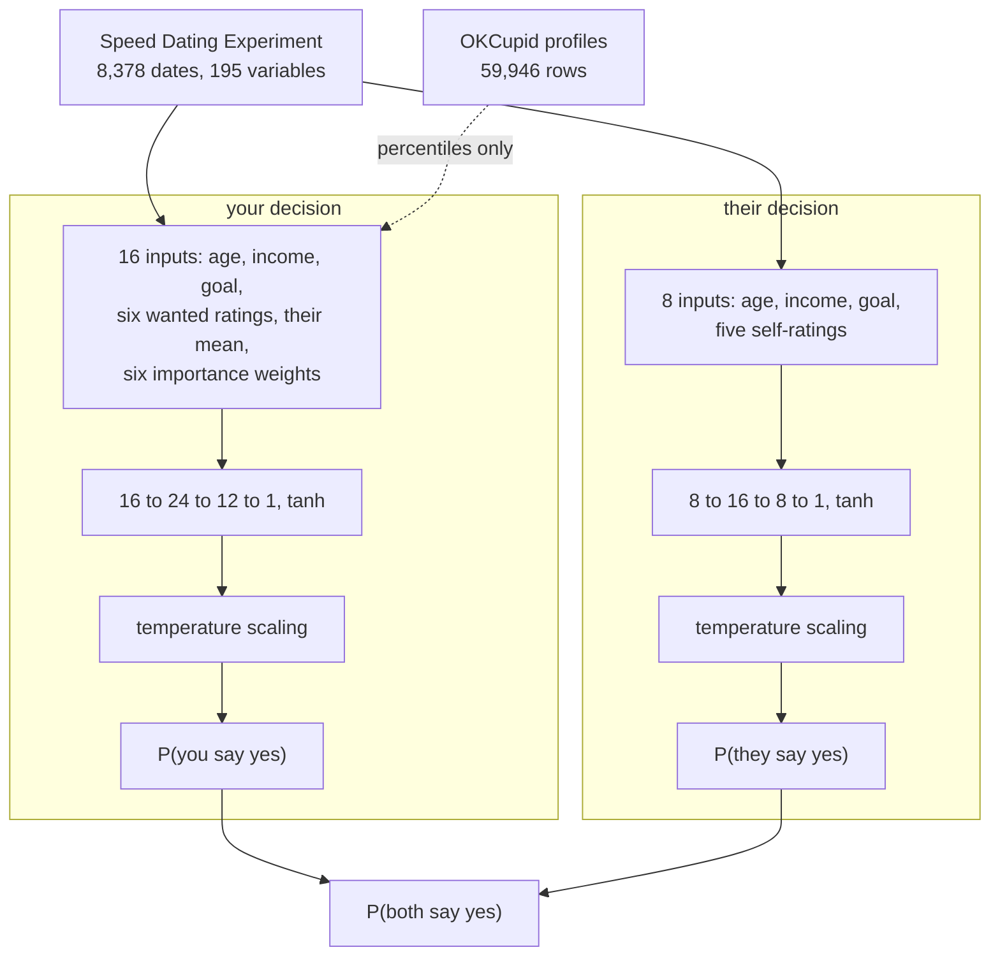
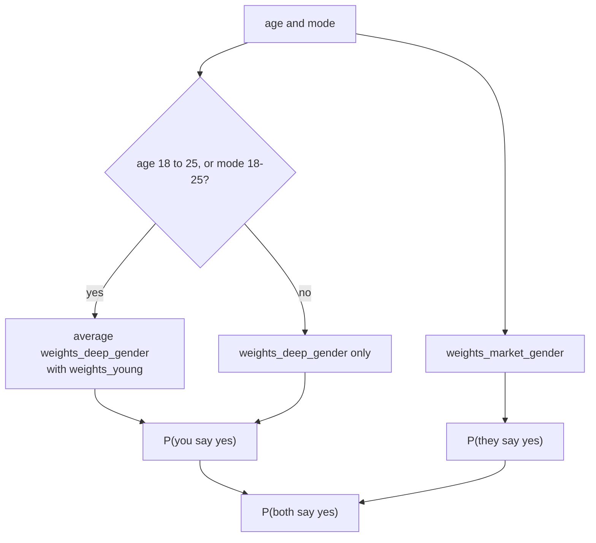
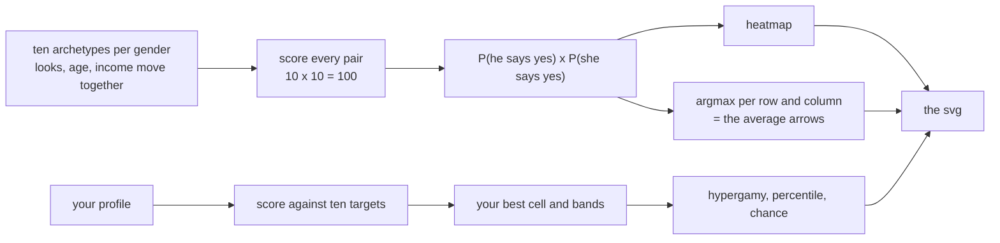
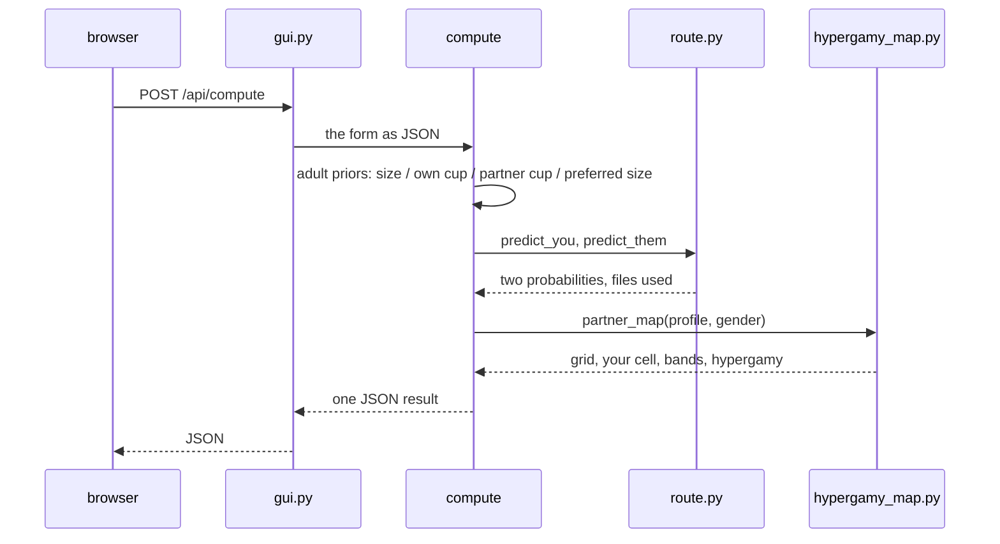

# How it works

The two networks, the GUI and the map, in order. **v1.3.0** adds the responsive
interface, separate anatomy fields, and the regression suite described at the end.

## Two halves, one product



The product assumes the two decisions are independent. The data nearly agrees: 47.4%
x 36.5% = 17.3% predicted against 16.5% observed.

## Which weights run



The page prints the files it loaded, so the routing is never a guess.

## Anatomy fields (v1.3.0)

The date model has no anatomy column, so these are capped **research** priors in
`adult.py`, never trained outcomes. There are four fields because the two sides of the
dyad need different numbers:

| field | shown for | side it moves |
|---|---|---|
| `size_cm` | a man | `d_them`: his size |
| `own_cup` | a woman | `d_them`: her own chest |
| `cup` | a date who is a woman | `d_you`: the date's chest |
| `partner_size_cm` | a date who is a man | `d_you`: the user's preferred size |

When the pair changes, `syncAnatomy()` in `gui.py` hides the irrelevant controls. A
man dating women sees his size and their cup; a woman dating men sees her own cup and
her preferred penis size. The tests assert the direction of each field and that the
fields for the other side do not move the result. `cup_key()` normalises `DD/E`,
`E` and `F or larger`; an unknown label falls back to the middle category rather than
inventing an effect.

## How the map is built



Hypergamy is the balance of your ambition weight against your looks weight, on -10 to
+10. Attractiveness is your position among the ten same-gender packages. The bands are
relative to your own best cell: 60% or more is likely, 25% to 60% is stretch, below that
is hard.

Both directions of each cell come from the dyad models, so each package carries its own
yes-rate. The older map used one market score for every column, which made the top
package look easy by construction; that is gone. `attractiveness` remains the separate
market-model summary and is labelled as the weaker 64-66% model.

## The GUI



The result hierarchy is deliberate: the three chances come first, then the reaching
gap and verdict, then the map, the package table, the generated person, and finally the
adjustment and evidence panels. Every adjustment carries a visible `trained`,
`measured`, `population` or `research` chip. The form uses labels above controls,
visible slider limits, keyboard-native range inputs, a live status line, and a
`prefers-reduced-motion` fallback. It is one column below 980 px and two columns above;
the six rating grids go from three columns to two at 980 px and one at 560 px.

## Tests (v1.3.0)

```bash
python -m unittest discover -s tests -v
```

15 tests cover the reference profile, average man and woman, eight edge cases, 20
seeded random profiles, JSON/NaN safety, map dimensions and argmax consistency, the
committed CV metadata, anatomy direction/ignored-field invariants, and the HTML
accessibility hooks. The full `python -m py_compile` and `node --check` checks are also
part of the release verification.

## Philosophy

* **Predictions before poetry.** A probability is printed only when a trained network
  produced it; everything else carries its label.
* **Calibration, not confidence.** Temperature scaling makes a 0.9 mean 0.9 on held-out
  data and never changes a decision.
* **Archetypes are a ruler.** The ten levels rank packages; no real person is level 7.
* **The weaker model is reported.** The market side is 64 to 66% accurate, and the map
  says so instead of hiding it.

## Sources

* **Speed Dating Experiment**, Columbia 2002-04 (Fisman and Iyengar), CC0: 8,378 dates,
  195 variables; targets `dec`, `dec_o`, `match` (16.5%).
* **ACS 2023 1-year PUMS**, Census, CA/TX/FL/NY/IL: 250,172 opposite-sex couples,
  500,344 rows; measured context only (realised couples, not dates).
* **NHANES 2021-2023**, CDC DEMO_L + BMX_L: 6,262 measured heights; height percentiles.
* **OKCupid profiles**, JSE 2016, 59,946 rows: percentiles only, no outcome column.
* **Height:** Stulp et al. 2013, 5,782 speed-daters; PLOS ONE 2013 on realised couples;
  Ong 2014 on short women trading income for height.
* **Body:** Veale et al. 2015 (BJU International); Lever et al. 2006; Swami and Tovee
  2013; Breast Size Satisfaction Survey 2020.
* **Compatibility:** Holvoet et al. 2017 (n=1,027); Baranowski et al. 2021 (Norway,
  n=4,148); Joyal and Carpentier 2017; Willoughby et al. 2013 (n=1,054 couples).
* **Anatomy priors:** the cup and size effects are the same capped research priors
documented in `adult.py`; no public dataset here pairs them with a second date.
