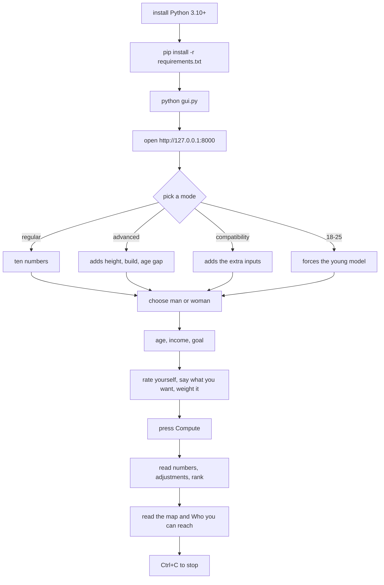

# HYPERGAMY

A neural network trained on **8,378 real speed dates**, drawn as a 10 x 10 hypergamy
map, and wrapped in a local tool that estimates **your chance of a mutual yes**, **how
hypergamous you are**, and **which partners are actually in reach**.

Every number below comes out of trained weights. No decorative arrows, no invented
statistics.


## The map

Rows are men, columns are women, each cell is P(he says yes) x P(she says yes).

* **the heatmap** — 100 real forward passes, not a drawing.
* **the arrows** — what average people do: each man points at the woman he is most
  likely to match with, each woman at the man she is most likely to match with, black
  dot for his best column, blue dot for her best row.
* **your arrow** — the thick line and the boxed cell, next to your **hypergamy score
  between -10 and +10**, your **attractiveness percentile against same-gender
  competitors**, and your **chance** at the level you reach best.
* **the ten levels are packages**: looks, age and income move together, which is why the
  grid has structure instead of one bright column.


## Who you can reach

| share of your best cell | band | what it means |
|---|---|---|
| 60% or more | **likely** | in range on these stats |
| 25% – 60% | **stretch** | needs something to change |
| below 25% | **hard** | out of reach on these stats |

## Quick start

```bash
python -m pip install -r requirements.txt
python gui.py
```

Open `http://127.0.0.1:8000/`, fill the form, press **Compute**. The profile is created
in the GUI, not on the command line.



## What is trained (both genders)

| model | inputs | architecture | 5-fold CV | baseline |
|---|---|---|---|---|
| taste, men | 16 | 16 → 24 → 12 → 1 | **81.1% ± 2.1** | 50.1% |
| taste, women | 16 | 16 → 24 → 12 → 1 | **80.3% ± 1.8** | 65.8% |
| market, men | 8 | 8 → 16 → 8 → 1 | 66.1% ± 2.5 | 61.5% |
| market, women | 8 | 8 → 16 → 8 → 1 | 63.9% ± 2.0 | 55.8% |

Six weight files plus the base model and the 18–25 model are committed. The market side
is weaker on purpose: age, income and self-ratings say less about someone else's yes than
about your own.

Height, body type, age gap and the compatibility inputs are **not trained** — no public
dataset pairs them with a second date. They run on a documented prior, capped at 8
points, and every row prints its basis: `measured`, `population` or `research`. Sources
and the whole table: `python adult.py`.

## Releases

Each release ships **`hypergamy-runtime.zip`** — GUI, map, command line, weights and both
charts, about 56 KB, 18 files, nothing to train. Build it with
`python tools/make_zip.py`; `.github/workflows/release.yml` attaches it to every
published release. Download: [the latest release](../../releases/latest).

## Limits

The market model is 64–66% accurate, so the chance is an estimate with real error bars.
Partner income is not in the data. The levels are archetypes, and the bands are relative
to your own best cell.
