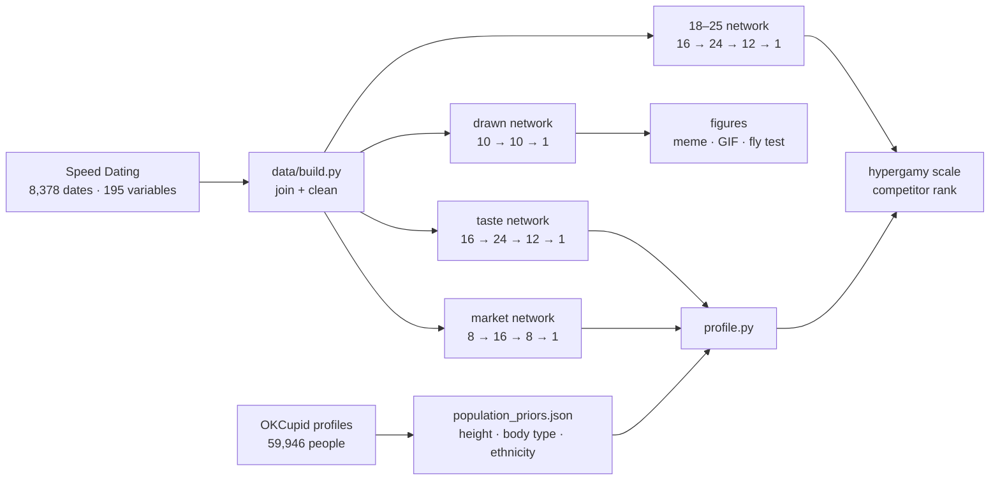
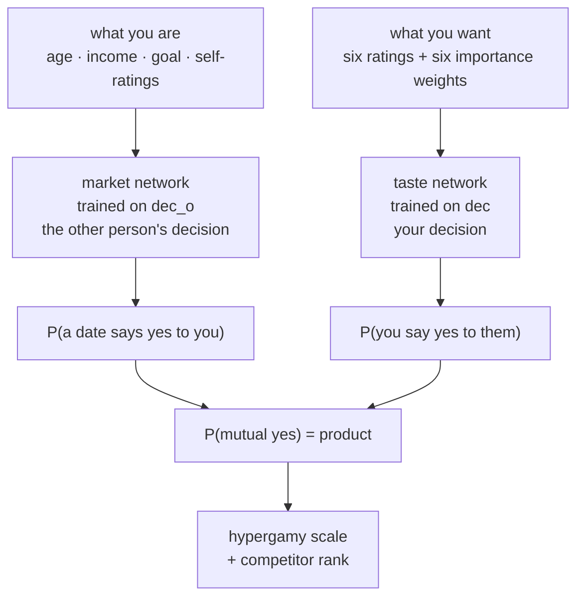
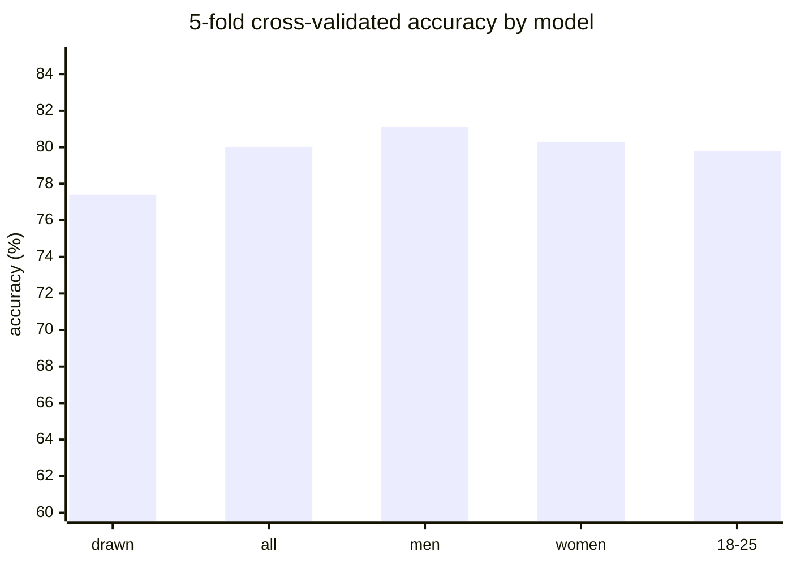
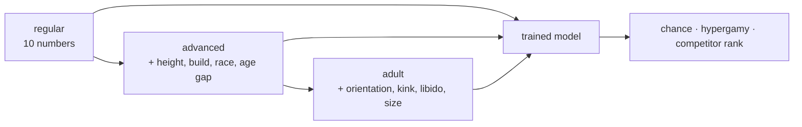
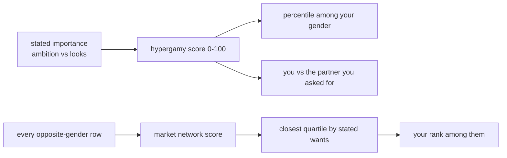
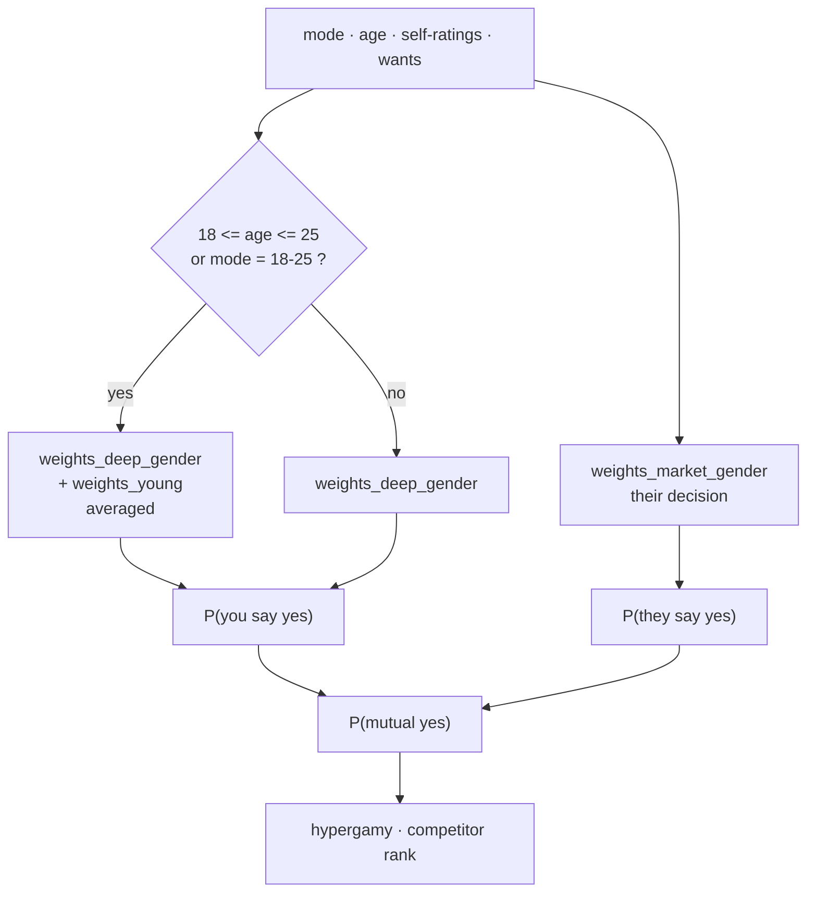

# HYPERGAMY

A neural network trained on **8,378 real speed dates**, drawn as the hypergamy meme,
and wrapped in a profile tool that estimates **your chance of a mutual yes** and **how
hypergamous you are** — with regular, advanced and adult modes.

Everything below is computed. No decorative arrows, no invented statistics, no
"AI" that is a lookup table.



## The idea

The meme says women choose up and men choose down. The honest way to test a meme is to
train a real model on real choices and then look at what it does, including where it
disagrees with the joke.

Two networks answer two different questions, and keeping them apart is the whole design:



Multiplying assumes independence. The data nearly agrees: 47.4% × 36.5% = 17.3%, against
an observed match rate of 16.5%.

## What was actually trained

| model | inputs | architecture | 5-fold CV | holdout | baseline |
|---|---|---|---|---|---|
| drawn (the meme) | 10 | 10 → 10 → 1 | 77.4% ± 1.2 | 75.8% | 57.0% |
| taste, all | 16 | 16 → 24 → 12 → 1 | **80.0% ± 0.9** | 76.5% | 57.0% |
| taste, men | 16 | 16 → 24 → 12 → 1 | **81.1% ± 2.1** | 81.3% | 50.1% |
| taste, women | 16 | 16 → 24 → 12 → 1 | **80.3% ± 1.8** | 76.2% | 65.8% |
| market, men | 8 | 8 → 16 → 8 → 1 | 66.1% ± 2.5 | 66.4% | 61.5% |
| market, women | 8 | 8 → 16 → 8 → 1 | 63.9% ± 2.0 | 61.6% | 55.8% |
| 18–25 only | 16 | 16 → 24 → 12 → 1 | **79.8% ± 0.8** | 82.3% | 55.6% |



Every run computes its own backprop check against central finite differences
(**2.5e-09** on the drawn model, limit 1e-5), a bootstrap interval, a majority-class
baseline, and refits medians and standardisation inside each CV fold.

Depth plus the stated preferences bought **+2.6 points** over the 10×10 network. The
market models are weaker on purpose-free grounds: knowing someone's age, income and
self-ratings predicts other people's choices far less well than knowing how they rate
the person in front of them. That is reported, not hidden.

## The three modes

| mode | inputs | where the numbers come from |
|---|---|---|
| `regular` | six self-ratings, six wanted ratings, six importance weights | trained taste + market networks |
| `advanced` | adds height, body type, race, age gap, desired income | networks **+ measured effects + real population percentiles** |
| `adult` | adds orientation, kink and libido compatibility, experience, body/size variables | networks **+ published research priors**, capped at ±8 points |



The adult mode is deliberately quiet about itself: it adds at most a few points, prints
`[research]` next to every adjustment it makes, and never claims to be trained. The
reason is simple — **nobody has published a dataset of kinks and body measurements paired
with second-date decisions.** Rather than invent one, the effects come from the
literature and the tool says so.

### What the research says

| claim | number | source |
|---|---|---|
| erect length, population mean | 13.12 cm / 5.17 in | Veale et al. 2015, 15,521 men |
| erect girth, population mean | 11.66 cm / 4.59 in | Veale et al. 2015 |
| women who say erect size is important | **15%** | Lever et al. 2006, 52,031 people |
| women satisfied with partner's size | **85%** | Lever et al. 2006 |
| men preferring medium breasts | 32.7% (large 24.4%, very large 19.1%) | Swami & Tovée 2013 |
| women wanting larger breasts | 47.5% (23.2% smaller, 29.3% satisfied) | Breast Size Satisfaction Survey, 18,541 women |
| BDSM fantasy / practice / identity | 40–70% / ~20% / 7.6% | Holvoet 2017; Joyal 2017; reviews |
| preferred height gap | women +25 cm, men −7 cm, matches peak at +19 cm | Stulp et al. 2013, 128,104 choices |
| desire discrepancy | common; predicts lower satisfaction | Willoughby et al. 2013, 1,054 couples |

That is why size sits in the *middle* of the scale rather than at the top: the evidence
says being near the population median is fine, the 75th–95th percentile helps slightly,
and the extreme top end stops helping. The tool encodes that shape instead of a fantasy.

## The hypergamy scale and the market

`visualize_scale.py` (and `profile.py --chart`) draws two things:



* **The scale** is the ratio of ambition to looks in what you say you want, placed
  against the same ratio for everyone else in the study, with your position and the
  position of the partner you asked for marked on it.
* **The market** scores every opposite-gender participant with the market network,
  keeps the quarter whose stated wants are closest to yours, and reports where you sit.
  "Top 25% of 1,156 competitors" is a measured rank, not a compliment.

The chart is a build artifact, not a committed file: `python visualize_scale.py` writes
`hypergamy_scale.png` locally, so the repository stays free of binary history.

### What the 18–25 check actually found

The hypothesis was that money matters less when you are young. In this data it does
**not** hold, and the result is reported rather than buried: on the same 18–25 rows,
the full-sample model's income slope from $12k to $140k is **−9.7 pp**, while the model
trained only on 18–25 rows is **+46.0 pp**. Income is blank on half the rows and filled
with training medians, and it is collinear with age, so treat this as a warning about
the data, not a finding about young people. It stays in the output.

## The GUI

One local page for every model. It is plain HTML served by the Python standard
library, so there is no toolkit to install and nothing is sent over the network.



Which weights run, exactly:

| your age | mode | models used |
|---|---|---|
| 18–25 | any | `weights_deep_{gender}.json` **+** `weights_young.json`, averaged |
| 26+ or under 18 | regular / advanced / adult | `weights_deep_{gender}.json` only |
| any | 18–25 | forces the young model, even outside the age range |
| any | any | `weights_market_{gender}.json` for the other person's decision |

The blend is an average of two probabilities, not a new network: both models read the
same 16 inputs, so there is nothing to concatenate. There is no age-specific *market*
model, so the market score always uses the gender model and the page says so.

### Step by step

1. Install Python 3.10 or newer.
2. Install the two dependencies:
   ```bash
   python -m pip install -r requirements.txt
   ```
3. Start the app:
   ```bash
   python gui.py
   ```
4. Your browser opens `http://127.0.0.1:8000/`. If it does not, open it yourself.
   Use `--port 9000` to change the port and `--no-browser` to stop it opening a tab.
5. Choose a **mode**: `regular`, `advanced`, `adult`, or `18-25` to force the young
   model. Choose **you are** man or woman.
6. Fill in age, income and dating goal (1–6, 4 = serious relationship).
7. Rate yourself on looks, sincerity, intelligence, fun and ambition (1–10).
8. Say what you want in a partner (1–10) and how much each thing matters (%, any scale).
9. In `advanced` and `adult`, extra fields appear: height, build, age gap, same race.
   In `adult`, the kink / libido / size / experience fields appear too.
10. Press **Compute**.
11. Read the three numbers (both say yes, they say yes, you say yes), then the
    adjustments with their `measured` / `population` / `research` label, the
    hypergamy percentile, and the competitor rank. The bottom lists the exact model
    files used and their cross-validated accuracy.
12. Press Ctrl+C in the terminal to stop the server.

The command line is still there (`python profile.py ...`) and prints the same numbers.

## Space and requirements

`requirements.txt` is two lines: `numpy` and `matplotlib`. The GUI itself needs
nothing beyond the standard library (no tkinter, no Flask, no browser install).

| what | approximate size |
|---|---|
| code, README, trained weights | under 0.2 MB |
| datasets after `python data/build.py` | about 7 MB (raw 5.0, joined 1.4, 18–25 0.6) |
| NumPy | about 41 MB |
| Matplotlib and its small dependencies | about 50 MB |
| a fresh virtualenv with both installed | roughly 130 MB |
| the GUI | 0 MB extra — standard library only |

The trained weights are **in the repository**, so a clone runs immediately. They are
rounded to 7 decimals and stored without indentation (`tools/compact_weights.py`
verifies that predictions move by less than 1e-5 before overwriting anything), which
keeps all seven models at about 44 KB instead of about 120 KB.

## Datasets

| dataset | rows | what it gives | what it cannot give |
|---|---|---|---|
| Speed Dating Experiment (Columbia, 2002–04) | 8,378 dates, 195 variables | the decision, both sides' ratings, stated preferences, self-ratings, race, age gap | height, body type, kinks, size |
| OKCupid profiles (JSE, 2016) | 59,946 profiles, 22 variables | real distributions of height, body type, ethnicity, orientation | any outcome — there is no decision column |

The two are not merged. Speed dating trains everything; OKCupid only supplies
population percentiles, and `adult.py` labels those `[population]`, not `[measured]`.

**There is no public dataset of adult preferences with dating outcomes.** The largest
real decision dataset is the speed-dating one, and it is 8,378 rows. It was not possible
to honestly make it "way bigger", so the upgrade here is *wider*: the full 195-variable
file instead of the 15-column convenience copy, joined with the income column that only
the convenience copy has.

## Run it

```bash
python -m pip install -r requirements.txt   # numpy + matplotlib
python gui.py                   # the GUI, http://127.0.0.1:8000
python data/build.py            # downloads + joins the datasets (needed for ranks)
python train.py --snapshots     # the drawn 10x10 model + animation frames
python train.py --features taste --layers 24,12 --epochs 400 --lr 0.05 \
                --gender 1 --out weights_deep_men.json
python train.py --features taste --layers 24,12 --epochs 400 --lr 0.05 \
                --gender 0 --out weights_deep_women.json
python train.py --features market --target dec_o --layers 16,8 --gender 1 \
                --out weights_market_men.json
python train.py --features market --target dec_o --layers 16,8 --gender 0 \
                --out weights_market_women.json
python train.py --features taste --layers 24,12 --min-age 18 --max-age 25 \
                --out weights_young.json
python visualize.py
python visualize_gender.py
python visualize_chance.py
python visualize_scale.py
python animate.py
python neurons.py
python predict.py --demo
```

Your own profile:

```bash
python profile.py --mode regular --gender 1 --age 24 --income 30000 \
    --self 7,7,7,7,5 --want 8,6,7,8,9,7 --importance 30,10,15,15,20,10

python profile.py --mode adult --gender 0 --age 25 --income 42000 --height 66 \
    --body curvy --age-gap 2 --kink 5 --libido 4 --experience 4 --chart

python profile.py --demo        # three worked examples, one per mode
python adult.py                 # the effect table, prevalence and sources
```

The trained weights are committed, so nothing above has to be trained to use the app;
the `train.py` lines are there to reproduce them. If a weights file is missing,
`profile.py` prints the exact command that recreates it. Without the CSVs the app still
scores a profile from the weights and says which parts it skipped.

`main` carries the code and ignores the generated CSVs. A local `with-data` branch adds
`data/*.csv` (1.4 MB and 619 KB) when you want them versioned.

## Is it real?

* backprop checked against finite differences on every run;
* 5-fold CV with medians and scaling refit inside each fold;
* probabilities temperature-calibrated on held-out data, so a 0.9 is not a 0.999;
* the drawn network's 100 arrows are the actual `W1` matrix;
* the fly test clamps real neurons and counts decisions that reverse (#6 reverses 4,230);
* every adjustment in advanced/adult mode is printed with its basis: `measured`,
  `population` or `research`.

## Limits

The speed dates are 2002–2004 and last four minutes; a "yes" is a second date, not a
marriage. The market model is 64–66% accurate, so the chance it prints is an estimate
with real error bars. Partner income is not in the data, so "status" is ambition plus
your own income. Adult effects are priors, not learned weights, and are capped so they
cannot dominate the trained models.
