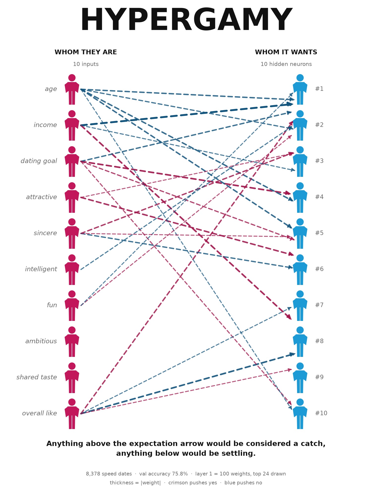
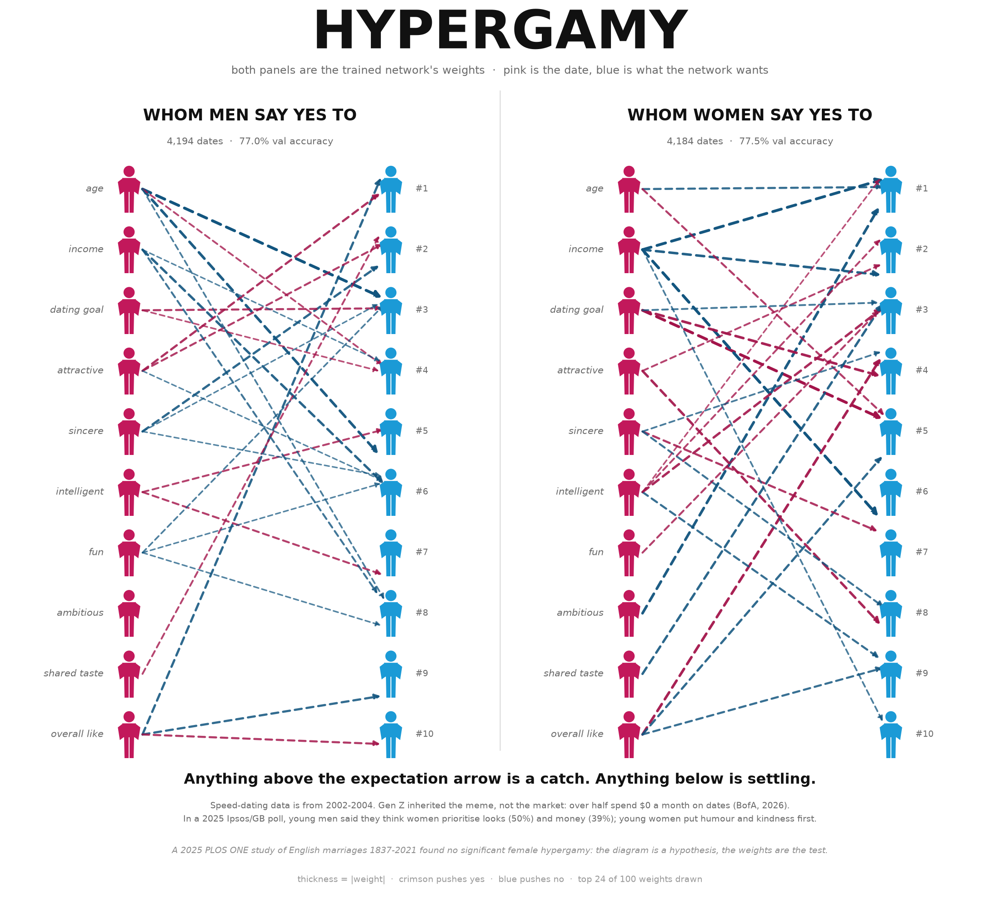
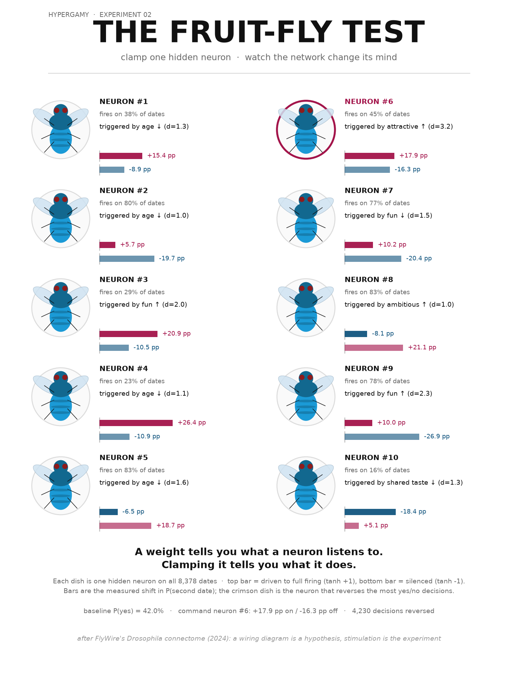

# HYPERGAMY: a neural network, drawn like the meme

A tiny 10 → 10 → 1 network written from scratch in NumPy, trained on 8,378 speed
dates, rendered as the hypergamy diagram — then split into the meme's two panels,
interrogated one neuron at a time, and animated while it learns.







## Dataset

**Speed Dating Experiment** — Kaggle: [`annavictoria/speed-dating-experiment`](https://www.kaggle.com/datasets/annavictoria/speed-dating-experiment)
(CC0, 2002–2004, Columbia University; Fisman & Iyengar, *Gender Differences in Mate
Selection*).

The copy in `data/speed_dating.csv` is a trimmed version of it (428 KB, 8,378 dates,
15 columns) hosted publicly here:
<https://raw.githubusercontent.com/keithmcnulty/speed_dating/master/speed_data_data.csv>

Each row is one four-minute date. The participant rated their partner 1–10 on
attractiveness, sincerity, intelligence, fun, ambitiousness and shared interests,
and then said whether they wanted a second date (`dec`).

Columns: `gender, age, income, goal, career, dec, attr, sinc, intel, fun, amb, shar, like, prob, met`

* 8,378 dates, 42.0% said yes.
* Only **3,581** rows are complete on the 10 inputs; `income` alone is blank on half
  the dataset. The rest are filled with **training-set medians**, so all 8,378 dates
  contribute. Medians are stored in `weights.json` and reused at inference.
* `gender` is 0 = women, 1 = men in the Kaggle codebook. The data agrees: the
  gender-0 careers are social work/teaching, gender-1 are consulting/finance.

## The network

```
10 inputs            hidden layer        output
age       ┐    ┌── h1 ──┐
income    ├────┼── h2 ──┤
goal      ├────┼── h3 ──┼──── P(second date)
attr      ├────┼  ...   ┤
sinc      ├────┼── h9 ──┤
intel     │    └── h10 ─┘
fun       │
amb       │    W1: 10x10   ← this is what gets drawn
shar      │    W2: 10x1
like      ┘
```

* hidden units: `tanh`, 10 of them
* output: `sigmoid` (binary cross-entropy)
* optimiser: Adam, lr 0.08, **L2 1e-3, 300 full-batch epochs** (chosen by 5-fold CV)
* **5-fold CV 77.4% ± 1.2%**, holdout **75.8%** (95% CI 73.8–77.9%) against a
  **57.0% majority-class baseline**, i.e. **+18.8 pp**
* a date rated 10/10 on every attribute (age 27, looking for a relationship) gets
  **98.7%**

That is up from 76.5% CV for the first version (3,581 complete rows, 900 epochs, no
L2). The gain came from using all the data and regularising, not from a bigger
network — the 10×10 layer is the joke, so it stays.

## Is it real?

`train.py` proves it on every run instead of asking you to trust it:

* **Backprop is checked against central finite differences**: worst error
  **2.5e-09** of the largest gradient (limit 1e-5). Per-element relative error is
  useless here because saturated tanh units have ~1e-11 gradients; the metric is
  scale-normalised, and that trap is documented in `AGENTS.md`.
* **Accuracy is reported against the trivial baseline**, with a bootstrap interval
  and a 5-fold CV number where medians and standardisation are refit inside each
  fold — no leakage.
* **Training is deterministic**: same seed, same weights, byte-identical PNG.
* **Inference uses saved training statistics** (`mu`, `sigma`, `impute`), so
  `predict.py` and `neurons.py` cannot silently skew from training.

## Whom men say yes to, whom women say yes to

The meme's actual format is two panels. So: two networks, one per side, same
architecture, trained on each participant group's decisions.

| | men (4,194 dates) | women (4,184 dates) |
|---|---|---|
| 5-fold CV | **78.4% ± 0.9%** | **76.8% ± 0.5%** |
| holdout | 77.0% | 77.5% |
| majority baseline | 50.1% | 65.8% |
| lift | **+26.9 pp** | **+11.7 pp** |

The honest result: **the two panels are more alike than the meme implies.** Both
funnel into a handful of dominant attributes, and their holdout scores are half a
percentage point apart. What differs is the mix of arrows, not the existence of a
funnel. Women said no far more often (65.8%), which is why the women's panel has a
higher baseline and a smaller lift.

## The fruit-fly test

In 2024 the FlyWire consortium published the complete connectome of an adult
*Drosophila*: every neuron, every synapse. A wiring diagram is a hypothesis about
what a neuron does; the experiment is to switch the neuron on and watch the animal
behave. `neurons.py` runs the same protocol on this network, which is small enough
to test exhaustively.

For each of the 10 hidden neurons, over all 8,378 dates: clamp it to `+1`
(stimulate), clamp it to `-1` (silence), recompute every prediction, and count the
yes/no decisions that actually reverse.

* **Neuron #6 is the command neuron.** Stimulating it adds **+17.9 pp** to the
  average probability, silencing it costs 16.3 pp, and it reverses **4,230**
  decisions. Clamping it on alone turns **2,201 of 4,996 "no" dates into "yes"**.
  It is triggered by *high attractiveness* (d = 3.2).
* **Neuron #9 has the largest mean shift**: silencing it drops the average by
  26.9 pp.
* **Three of ten neurons flip nothing** (#5, #8, #10): they move the average without
  ever crossing the decision line. Most of the layer modulates; a few decide.

## Gen Z field notes

Researched because the meme is mostly shared by people the data predates. The
speed-dating study is 2002–2004; its participants are today's parents.

* **The belief is gendered, and measurable.** In a May 2025 Ipsos/JOE poll of 2,475
  UK adults, young men said they think women prioritise looks (50%) and financial
  status (39%). Young women themselves ranked humour and kindness first.
  → [Ipsos](https://www.ipsos.com/en-uk/young-men-believe-women-prioritise-attractiveness-and-financial-status-when-dating-young-women-say)
* **Money is the Gen Z dating topic.** Over half of Gen Z report spending nothing on
  dates in a typical month (Bank of America *Better Money Habits*, 2026), and 47% of
  men — versus 34% of women — still think the man should pay for the whole date
  (Talker Research for Chime, 2025).
  → [BofA report](https://newsroom.bankofamerica.com/content/dam/newsroom/docs/2026/BofA_BMH_2026_GenZ_Report.pdf),
  [Talker](https://talkerresearch.com/younger-singles-find-income-transparency-attractive)
* **The strong hypergamy claim does not survive long-run data.** A 2025 PLOS ONE
  study of English marriages from 1837 to 2021 found **no significant hypergamy by
  women**, measured by fathers' occupational status and surname-linked house values.
  → [PLOS ONE](https://journals.plos.org/plosone/article?id=10.1371/journal.pone.0316769)

None of this is required to enjoy the diagram. It is there so the caption can say
"the diagram is a hypothesis, the weights are the test" and mean it.

## Try it on a date

```bash
python predict.py                  # prompts for the ten inputs, Enter = default
python predict.py attr=10 fun=9    # or pass overrides directly
python predict.py --demo           # three canned dates
```

It prints the probability and the exact logit decomposition — `b2 + Σ a_j·W2_j` —
with the same `#1..#10` labels as the drawings.

## Running it

```bash
python -m pip install numpy matplotlib
python train.py                 # all participants -> weights.json + training_frames.npz
python train.py --gender 1 --out weights_men.json
python train.py --gender 0 --out weights_women.json
python visualize.py             # -> hypergamy_network.png
python visualize_gender.py      # -> hypergamy_men_women.png
python animate.py               # -> training.gif (30 frames, ~1 MB)
python neurons.py               # -> fruitfly_neurons.png
python predict.py               # score one date, neuron by neuron
```

## How the drawing works

* **Left column** = the 10 inputs, one pink person each.
* **Right column** = the 10 hidden neurons, one blue person each.
* **Arrows** = the 10×10 weight matrix of layer 1. Arrowhead points at the neuron,
  thickness and opacity scale with `|w|`, crimson = positive, blue = negative.
* Only the **24 strongest** of the 100 connections are drawn per panel. All 100 is soup.
* Hidden units are **sorted by total incoming weight** so popular neurons sit at the
  top; hidden units are permutation-symmetric, so the order is free to choose.
* That sorted order defines **`#1..#10` in every figure and in `predict.py`**.
* The **GIF** replays the training snapshots (every 10 epochs) with the final column
  order fixed, so you see the weights move rather than the neurons jump.

The one thing that isn't a joke: every arrow is a trained weight, every bar in the
fly figure is a re-run of the network, and the Gen Z lines are sourced.
