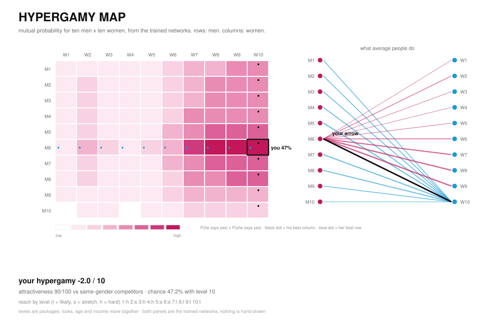
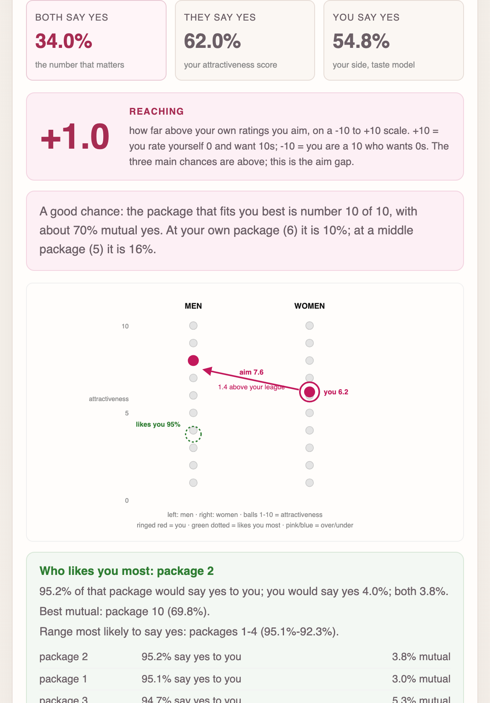
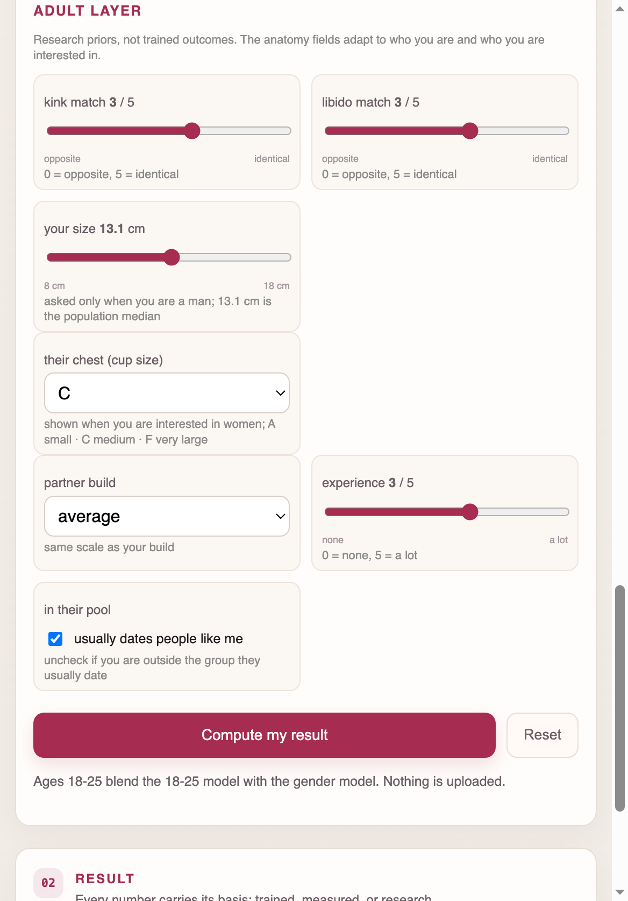
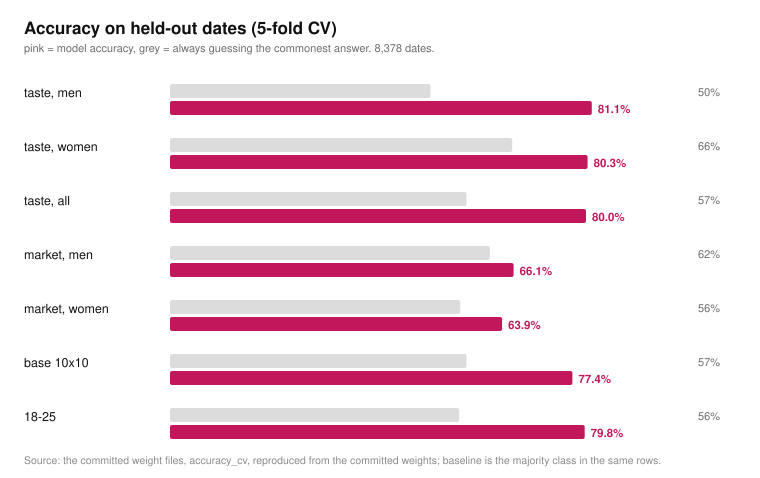
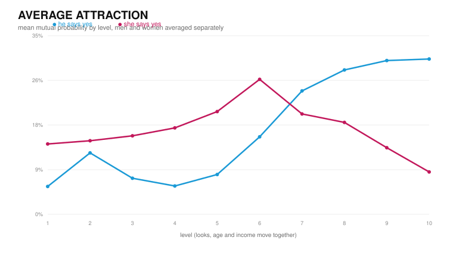

# HYPERGAMY

A neural network trained on **8,378 real speed dates**, drawn as a 10 x 10 hypergamy
map, and wrapped in a local tool that estimates **your chance of a mutual yes**, **how
far above your own ratings you aim (reaching)**, and **which partners are in reach**.

Every number is **trained**, **measured** from a named dataset, or explicitly labelled
a **research prior**. No decorative arrows and no invented statistics.

**v1.6.1** fixes the release zip: it now includes `partner.py` and the `data/build*.py`
scripts, so the downloaded runtime can start the desktop GUI and rebuild the priors.
**v1.6.0** makes the native Tk desktop window the default local GUI; the browser page
remains behind `python gui.py --serve`. **v1.5.1** fixed the result screenshot alignment
on the Pages site, explains the map's best-cell rings in place, and adds a
data-provenance audit: OKCupid has no date-outcome label, so it is not a training set.
**v1.5.0** turns the promo map into an explorer:
switch between the mutual chance and
either direction, pin a package pair, and toggle the best-cell markers. The static map's
markers are now high-contrast rings, and the calculator result panel stays in view while
you edit. **v1.4.1** made the education intake optional; **v1.4.0** added the measured
partner panel, the NHANES height context, the reach bands, and the 23-test regression
suite. The date model and its CV numbers are unchanged from v1.2.1.







## Does it actually predict anything?

The graph is the honest answer: five-fold cross-validation on dates the model never saw,
next to the score you get by always guessing the commonest answer.



| model | inputs | 5-fold CV | always-guess baseline | lift |
|---|---|---|---|---|
| taste, men | 16 | **81.1% ± 2.1** | 50.1% | +31.0 |
| taste, women | 16 | **80.3% ± 1.8** | 65.8% | +14.5 |
| taste, everyone | 16 | **80.0% ± 0.9** | 57.0% | +23.0 |
| market, men | 8 | 66.1% ± 2.5 | 61.5% | +4.6 |
| market, women | 8 | 63.9% ± 2.0 | 55.8% | +8.1 |
| dyad, men | 20 | **80.9% ± 1.1** | 50.1% | +30.8 |
| dyad, women | 20 | **79.5% ± 0.5** | 65.8% | +13.7 |
| map / base | 10 | 77.4% ± 1.2 | 57.0% | +20.4 |
| 18-25 | 16 | 79.8% ± 0.8 | 55.6% | +24.2 |

The taste models (will *you* say yes) clear their baselines by 15-31 points. The market
models (will *they* say yes) are weaker, +5 to +8 points: whether a stranger says yes is
mostly noise. The dyad models answer the target-specific question and land in between.
The app prints the taste and market CVs next to the numbers; the dyad CVs are above and
in `AGENTS.md`. Re-checked against the committed weights: holdout accuracy 75.8-81.3%
for the taste models, 61.6-66.4% for market, 78.3-81.3% for dyad.

## The map

Rows are men, columns are women, each cell is P(he says yes) x P(she says yes).

* **the heatmap** — 100 real forward passes, not a drawing.
* **the arrows** — what average people do: each man points at the woman he is most
  likely to match with, each woman at the man she is most likely to match with, black
  dot for his best column, blue dot for her best row.
* **your arrow** — the thick line and the boxed cell, next to your **reaching score
  between -10 and +10**, your **attractiveness** (the share of dates who would say yes
  to you) and your **chance** at the package you reach best.
* **the ten rungs are packages**: looks, age and income move together, which is why the
  grid has structure instead of one bright column.



## What each package is

The rows and columns are **packages**, not ten real women or men. A package is one rung
of a made-up ladder: looks, age and income climb together, and each rung is 10% of the
ladder. Package 1 is the bottom rung, package 10 the top.

| package | looks | age | income |
|---|---|---|---|
| 1 | 3.0 / 10 | 24 | $21.0k |
| 2 | 3.8 / 10 | 25 | $25.5k |
| 3 | 4.6 / 10 | 26 | $30.0k |
| 4 | 5.3 / 10 | 27 | $34.5k |
| 5 | 6.1 / 10 | 28 | $39.0k |
| 6 | 6.9 / 10 | 30 | $43.5k |
| 7 | 7.7 / 10 | 31 | $48.0k |
| 8 | 8.4 / 10 | 32 | $52.5k |
| 9 | 9.2 / 10 | 33 | $57.0k |
| 10 | 10.0 / 10 | 34 | $61.5k |

So "package 10" is **a 34-year-old on about $61.5k rated 10/10 on looks** — the top rung
the model builds, not "the perfect woman", and not a score out of ten. The age and income
climb is what makes the grid a diagonal instead of one bright column.

## Who would like you most

The map uses the two **dyad** models for both directions. Each package now has its own
"would say yes to you" probability, so a row is not one constant market score: the
package-specific yes-rates are 80.9% CV for men and 79.5% for women. Those are weaker
than the taste models, but they are the right model for a target-specific question.

`attractiveness` is still the separate market model's one-number summary: the share of
dates in the study pool it expects to say yes to someone with your stats (age, income,
goal, self-ratings). It is **not** a per-package guarantee, and it is the weaker 64-66%
model. The app prints both so the two claims stay separate.

## Who you can reach

| share of your best cell | band | what it means |
|---|---|---|
| 60% or more | **likely** | in range on these stats |
| 25% – 60% | **stretch** | needs something to change |
| below 25% | **hard** | out of reach on these stats |

## The measured couple market

The GUI now puts the speed-date estimate next to **250,172 opposite-sex couples from the
2023 ACS** (CA, TX, FL, NY, IL) and **6,262 measured heights from NHANES 2021-2023**.
The panel reports the couple cell for your age and income: partner age, partner personal
income, age gap, partner-income ratio, same-ethnicity share, same-education share and
your measured height percentile. Those are **descriptive facts about realised couples**,
not dating decisions, and they never feed the date-acceptance network.

The source files are not committed: the builders download them and write the small
`data/couple_priors.json` and `data/height_priors.json`. Use
`python data/build_couples.py --states ca,tx,fl,ny,il` and `python data/build_height.py`
to reproduce them.

## Anatomy fields in v1.3.0

The adult layer has **four separate anatomy inputs**, because one field cannot mean the
same thing for every pair. All four are `research` priors, not trained outcomes.

| field | shown when | changes |
|---|---|---|
| your size | you are a man | their yes (**their** side) |
| your chest (cup size) | you are a woman | their yes (**their** side) |
| their chest (cup size) | the date is a woman | your yes (**your** side) |
| preferred penis size | the date is a man | your yes (**your** side) |

A man entering his own size and a woman entering her preferred size are therefore not
the same number, and a woman's own chest does not leak into her preference. The form
hides the fields that cannot apply, and the tests check the direction of every field
plus the fact that the ignored fields leave the result unchanged.

## What the research says about age and "types"

The GUI shows the evidence rather than silently turning it into a multiplier:

* **Money and age.** Fales et al. 2016 found steady-income importance rising toward
  about age 40 then declining; Botzet et al. 2023 (17,254 women, 18-67) found negligible
  age effects; Schwarz & Hassebrauck 2012 (21,245 adults) found small ones. This is a
  small average curve, not a law, and it is not applied as a probability shift because
  the speed dates have no partner-income preference question.
* **Height and age.** The large studies do not show a reliable decline in the importance
  of height with age. The robust effects are own height, gender and the height gap.
  The only interaction used is a narrow own-height prior from Ong 2014: shorter women
  weight height a little more (0.90x to 1.15x); there is no age multiplier.
* **"Types".** There is evidence for same-race and same-education sorting (Hitsch et al.
  2010; Hwang 2013), and for height/income trade-offs that vary by own height. No public
  dataset here identifies "goth", "Latina goth" or any subculture, so the app does not
  invent that label. The ethnicity field is only for the measured ACS context.

## Quick start

```bash
python -m pip install -r requirements.txt
python data/build.py # recommended once: full couple context, calibration and ranking
python gui.py # native desktop window
```

A native desktop window opens; fill the form, press **Compute**. No browser and no
local server are used by default. The profile is created in the GUI, not on the
command line. Use `python gui.py --serve` only if you want the legacy local
browser UI at `http://127.0.0.1:8000/`. On most Windows/macOS Python installs Tk is
included; on Debian/Ubuntu install the `python3-tk` system package if the desktop
window cannot start. Modes: **regular** (self, want and importance),
**advanced** (+ height, build, age gap, ethnicity), **adult** (+ kink, libido, and the
anatomy fields), **18-25** (force the young model). Pick who you are and who you are
interested in; same-gender pairings are flagged as an extrapolation because the study
only recorded opposite-gender dates. Ethnicity is used only for the measured ACS
context; it is not a trait score and does not change the trained date decision.

In adult mode the anatomy controls follow the pair: a man enters his own size and,
when the date is a woman, her cup; a woman enters her own cup and, when the date is a
man, her preferred penis size. The unused controls are hidden, not silently scored.

## What is trained (both genders)

The committed weights include the base map, the all-person taste model, the two gender
taste models, the two market models, the 18-25 model, the two dyad models and the two
person-generator models. Height, body type, age gap and the compatibility inputs are
**not trained** - no public dataset pairs them with a second date - so they run on a
documented prior, capped at 8 points, and every row prints its basis: `measured`,
`population` or `research`.

The networks, the routing, the map generation and every source:
**[HOWITWORKS.md](HOWITWORKS.md)**. The effect table: `python adult.py`.

### Why the 59,946 OKCupid profiles are not training rows

The public OKCupid file has no date-decision or mutual-match column. A supervised
acceptance model needs that label; fitting one anyway would mean inventing the target.
OKCupid is used only for descriptive height and body priors, never as a yes/no example.
HCMST has relationship outcomes, not date decisions, and is cited rather than shipped.
The public “online dating matches” Kaggle dataset is synthetic and excluded. No additional
real, redistributable profile-to-match dataset was found for this release.

## Testing

```bash
python -m unittest discover -s tests -v
```

The current suite has **26 tests**: the reference profile, an average man, an average
woman, eight edge cases (age 18/80, income $0/$10M, height 140/210 cm, all 0s and
all 10s, same-gender pairs), 20 seeded random profiles, JSON/NaN checks, 10x10 map
invariants, the committed CV metadata, the anatomy directions, the HTML hooks, and
three native-GUI payload/format checks.

Reference profile (man, 18, $4,500, `[6,8,7,7,3]` self, `[6,7,6,6,5,5]` want):
**58.72%** they say yes, **1.63%** you say yes, **0.96%** both; best package 7 at
**28.58%**. Average man: **60.56% / 6.59% / 3.99%**; average woman:
**88.24% / 4.34% / 3.83%**. Across 100 seeded random profiles the mutual range was
0.03% to 83.36%, median 16.67%, with no NaN or infinity.

## Releases

Each release ships **`hypergamy-runtime.zip`** - GUI, map, command line, weights and the
charts, nothing to train. Build it with `python tools/make_zip.py`;
`.github/workflows/release.yml` attaches it to every published release. **v1.3.0** is
the responsive-GUI and separate-anatomy release; the runtime zip contains the same
engine and weights as the source tag.
Download: [the latest release](../../releases/latest).

## Limits

The market model is 64-66% accurate, so `attractiveness` is an estimate with real error
bars. Package-specific yes-rates come from the weaker dyad models, and the person
generator still does not beat its baseline. The packages are archetypes, the bands are
relative to your own best cell, and ACS income is personal income, including zeros.
The four anatomy fields are capped research priors, not measurements of a real date;
they cannot move a result by more than the adult layer's 8-point cap.
Adding 250,172 couples did **not** raise the speed-date CV: those couples have a
different outcome (who married), not who said yes on a date.

## v1.4.0 — who you would most plausibly end up with

No data shipped here follows a person to a lifetime partner, so the app does not pretend
to predict one. `partner.py` answers the narrower, honest question:

* **measured** — for your age and income, the ACS 2023 realised-couple distribution:
  median partner age, partner income, age gap, same-ethnicity and same-education shares;
* **not scored** — the ACS records no partner self-ratings or stated importance, and the
  dyad models need both. Imputing them produced 52% mutual chances against a 16.5% base
  rate, so the candidates are shown as measured profiles without a model score;
* **research** — published directions on age gap and education homogamy only *order* those
  candidates (England 2016; Kraft & Neimann 2009; IZA 15749). No probability is attached.

HCMST is the right public panel for a lifetime-outcome model; it needs its own
registration and is deliberately not shipped or trained here.

Three fixes ship with it:

* the API converts NaN/Infinity to `null`, so a clone without `data/speed_dating_full.csv`
  returns valid JSON instead of `NaN`;
* profiles outside the study's support (for example $1,000,000 at 80) return a visible
  warning instead of a silent extrapolation;
* every result carries an in-sample calibration table (predicted vs actually observed yes)
  for the two headline models, because those probabilities are ranks, not frequencies.

    python partner.py --demo
    python partner.py --payload '{"gender":"man","age":18,"income":4500}'
