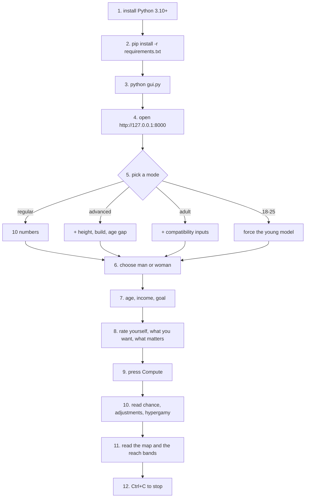

# HYPERGAMY

A neural network trained on **8,378 real speed dates**, drawn as a 10 x 10 hypergamy
map, and wrapped in a local tool that estimates **your chance of a mutual yes**, **how
hypergamous you are**, and **which partners are actually in reach**.

Every number below is computed from trained weights. No decorative arrows, no invented
statistics.

## The map

One picture, three answers.

* **rows are men, columns are women.** Each cell is P(he says yes) x P(she says yes),
  both probabilities from the trained networks. Brighter means more likely.
* **the arrows** are what average people do: every man points at the woman he is most
  likely to match with, every woman points at the man she is most likely to match with.
  A black dot marks each man's best column, a blue dot each woman's best row.
* **your arrow** is the thick black line and the outlined cell, built from your own
  numbers. It also prints your **hypergamy score between -10 and +10**, your
  **attractiveness percentile against same-gender competitors**, and your **chance** at
  the level you reach best.
* **the ten levels are packages**, not ten real people: looks, age and income move
  together, which is why the grid has structure instead of one bright column.

The second chart is the average yes rate at each level for each side:

## Who you can reach

`python profile.py --range` (and the GUI) classifies the ten levels relative to your own
best cell: **likely** at 60% or more of it, **stretch** between 25% and 60%, **hard**
below that. It is a model output with real error bars, not a promise.

## How to use it

